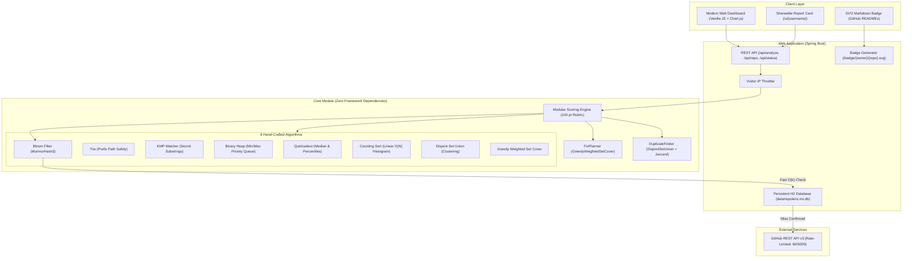

# RepoLens 🔍
### Deterministic GitHub Repository Hygiene & Standards Evaluator

[](#how-to-run)
[](#prerequisites)
[](#prerequisites)
[](docs/ALGORITHMS.md)
[](LICENSE)

RepoLens is a lightweight, zero-login repository hygiene evaluator. It inspects public GitHub repositories and scores their documentation, licensing, maintenance, engineering hygiene, safety, and directory structure on a deterministic 100-point scale.

> [!NOTE]
> **Important Clarification**: RepoLens evaluates repository **hygiene, maintenance habits, and open-source release readiness** (e.g. README completeness, license existence, CI workflows, unit test presence, and secret avoidance). It does **not** evaluate developer intelligence, coding ability, or runtime architecture.

---

## 🏛️ System Architecture

RepoLens follows a clean multi-module architecture:
- **`core`**: Pure Java library with **zero framework dependencies**. Implements all 8 foundational data structures and algorithms, scoring rubrics, the Greedy Set-Cover Fix Planner, and the DSU Duplicate Detector.
- **`web`**: Spring Boot application providing the REST API, persistent H2 storage, rate-limited GitHub client, live SVG badge service, and client-side reactive dashboard.



---

## 🔬 8 Hand-Crafted Algorithms

To ensure deterministic performance and zero external dependencies, `core` includes custom implementations of 8 algorithms (documented in detail in [`docs/ALGORITHMS.md`](docs/ALGORITHMS.md)):

1. **Binary Heap (`BinaryHeap.java`)**: Priority queue for ranking repositories best-to-worst in $O(n \log n)$ total time and extracting Top-$K$ priority actions in $O(n \log k)$.
2. **Trie (`Trie.java`)**: Digital tree for rapid prefix/exact scanning of repository file trees, detecting committed `.env`, private keys, and `node_modules/` in $O(L)$ time.
3. **Knuth-Morris-Pratt (`KmpMatcher.java`)**: Linear $O(n + m)$ pattern matcher with LPS $\pi$-table to scan README bodies for exposed secrets without quadratic backtracking.
4. **Disjoint Set Union (`DisjointSetUnion.java`)**: Union-Find with union by rank and path compression to group similar and duplicate repositories in nearly $O(1)$ amortized time ($O(\alpha(n))$).
5. **Greedy Weighted Set Cover (`GreedyWeightedSetCover.java`)**: Polynomial-time Chvátal approximation algorithm that formulates repository remediation as a set cover problem, selecting the most cost-effective fixes.
6. **Bloom Filter (`BloomFilter.java`)**: Bit-array with MurmurHash3 double hashing to avoid expensive disk lookups. **Zero false negatives**; positive matches are confirmed against the database.
7. **Quickselect (`Quickselect.java`)**: Hoare selection algorithm with median-of-three pivot selection to compute median hygiene scores and percentiles in $O(n)$ average time.
8. **Counting Sort (`CountingSort.java`)**: Non-comparison distribution sort that orders scores in bounded range $[0, 100]$ in strictly $O(n)$ linear time.

---

## 📊 100-Point Scoring Rubric

Repositories are evaluated against a standardized 100-point rubric (viewable live at `/rubric`):

| Category | Points | Key Inspection Criteria |
| :--- | :---: | :--- |
| **Documentation** | 25 | README exists, word count, installation & usage sections, screenshots/images, description, and topics. |
| **Licensing & Community** | 10 | Valid open-source LICENSE file, CONTRIBUTING guidelines, issue templates, PR templates. |
| **Maintenance** | 20 | Commit recency (<30d, <90d, <180d, <365d), commit frequency over last 30 commits, active (not archived). |
| **Engineering Hygiene** | 25 | Automated tests (`src/test`, `tests/`, `*_test.py`), CI workflow (`.github/workflows`), `.gitignore`, build config (`pom.xml`, `package.json`, etc.). |
| **Safety & Security** | 15 | Trie and KMP check for `.env`, private keys (`id_rsa`, `.pem`), `node_modules/`, `.DS_Store`, build junk, AWS keys. |
| **Project Structure** | 5 | Clean folder layout (`src/`, `lib/`, `app/`), avoidance of monolithic single-file repositories. |

---

## 🚀 Quickstart & Setup

### Prerequisites
- **Java**: JDK 17 or higher (`java -version`)
- **Maven**: Version 3.8 or higher (`mvn -version`)
- **GitHub Token (Recommended)**: Increases API rate limit from 60 to 5,000 requests/hr.

### 1. Configure GitHub Token
Set the token via an environment variable or create a `.env` file in the project root:

**Option A: Environment Variable (Recommended)**
```bash
export GITHUB_TOKEN="ghp_yourPersonalAccessTokenHere"
```

**Option B: `.env` File (Gitignored)**
Create `.env` in the repository root:
```env
GITHUB_TOKEN=ghp_yourPersonalAccessTokenHere
```

### 2. Run Tests & Benchmarks
Execute the full test suite (unit tests, algorithm tests, and empirical benchmarks):
```bash
mvn clean test
```

### 3. Run the Application
Start the Spring Boot web application:
```bash
mvn spring-boot:run -pl web
```
Or package and run the executable JAR:
```bash
mvn clean package -DskipTests
java -jar web/target/web-1.0.0-SNAPSHOT.jar
```

The application will start on `http://localhost:8080`.

---

## 🖥️ Web Endpoints & Features

| URL | Method | Description |
| :--- | :---: | :--- |
| `/` | `GET` | Interactive dashboard (Ranked Repos, Fix Plan, Duplicates, Stale Repos, Chart.js) |
| `/u/{username}` | `GET` | Shareable, neutral report card page for any analyzed GitHub user |
| `/rubric` | `GET` | Detailed breakdown of the 100-point scoring rubric |
| `/badge/{owner}/{repo}.svg` | `GET` | Live SVG shields-style badge displaying current repository score |
| `/api/analyze/{username}` | `GET / POST` | Runs analysis, scoring, heap ranking, Quickselect median, and fix plan |
| `/api/repo/{owner}/{repo}` | `GET` | Detailed deductions and points lost for a single repository |
| `/api/status` | `GET` | Remaining GitHub rate limit quota and total API requests saved by cache |

### Embedding Repo Badges in READMEs
Add your real-time RepoLens hygiene badge directly to your GitHub repository:
```markdown
[](https://your-domain.com/u/{owner})
```

---

## 📸 Screenshots

*(Place application screenshots in `docs/screenshots/`)*

| Main Dashboard | Fix Planner (Set Cover) |
| :---: | :---: |
|  |  |

| Shareable Report Card | Live SVG Badge Preview |
| :---: | :---: |
|  |  |

---

## ☁️ Deployment Guide (Free Hosts: Render / Railway / Fly.io)

RepoLens compiles into a single executable JAR with an embedded Tomcat server and persistent file-based H2 database.

### Docker Deployment
RepoLens includes standard Dockerfile support. Build and run locally or push to Docker Hub:

```dockerfile
FROM eclipse-temurin:17-jdk-alpine AS build
WORKDIR /app
COPY . .
RUN ./mvnw clean package -DskipTests

FROM eclipse-temurin:17-jre-alpine
WORKDIR /app
COPY --from=build /app/web/target/web-1.0.0-SNAPSHOT.jar app.jar
RUN mkdir -p /data
ENV PORT=8080
EXPOSE 8080
ENTRYPOINT ["java", "-jar", "app.jar"]
```

### Environment Variables
Configure the following in your host settings (Render / Railway / Fly.io / Heroku):

| Variable | Required | Default | Description |
| :--- | :---: | :---: | :--- |
| `GITHUB_TOKEN` | Yes | *None* | GitHub Personal Access Token (5,000 req/hr limit) |
| `PORT` | No | `8080` | Web server listening port (automatically bound by Render/Railway) |
| `SPRING_PROFILES_ACTIVE` | No | `prod` | Active Spring profile |
| `REPOLENS_CACHE_TTL_HOURS` | No | `6` | Analysis cache TTL in hours |
| `REPOLENS_THROTTLE_USERNAMES_PER_HOUR` | No | `10` | IP rate-limiting threshold |
| `REPOLENS_MAX_REPOS_PER_USER` | No | `50` | Maximum repositories analyzed per request |

### Deploy on Render (Free Web Service)
1. Fork or push this repository to GitHub.
2. In [Render Dashboard](https://dashboard.render.com), select **New Web Service** and connect the repository.
3. Set **Runtime** to `Java` or `Docker`.
4. Add Environment Variable:
   - `GITHUB_TOKEN` = `ghp_yourToken`
5. Click **Create Web Service**.

---

## 📚 References & Documentation
- **Algorithm Analysis & Viva Defense**: [`docs/ALGORITHMS.md`](docs/ALGORITHMS.md)
- **Empirical Benchmarks & Proofs**: [`docs/BENCHMARK.md`](docs/BENCHMARK.md)
- **Scoring Rubric**: Viewable at `/rubric` in the running application.
